# Hot Spotter bench arm — 2020 extrusion

The current arm is **20×20 mm aluminum extrusion** (V-slot or T-slot, 6 mm slot), not EMT. PETG printed parts bolt on with M5 T-nuts. A ball joint at the elbow and a second ball joint at the camera head lock with a printed knob, so aiming needs no tools. The phone carriage slides in the front slot.

Buy **one 1000 mm stick**. Cut **635 mm** for the post and **350 mm** for the crossbar. That leaves about 15 mm, which covers a saw kerf. With the foot under the post, the USB-C thermal camera lens sits about **611 mm** above the bench and **300 mm** out. Coverage is about **635 × 480 mm**, the same as the older tube arm. A 500 mm stick is too short for the post.

| On the bench | Joint, pulled apart | Section through the ball |
|---|---|---|
| 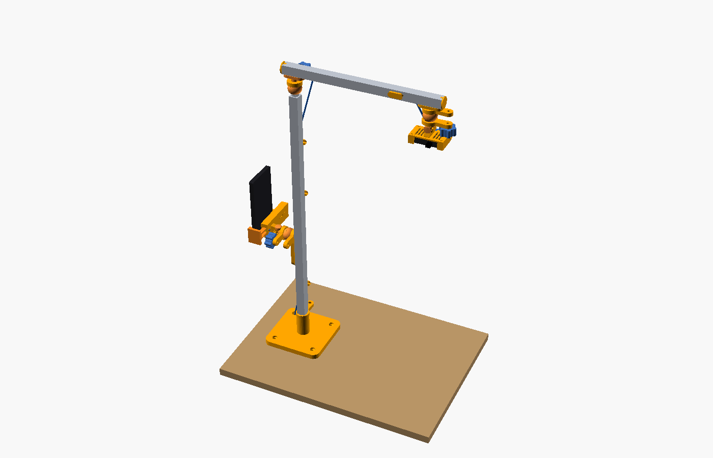 | 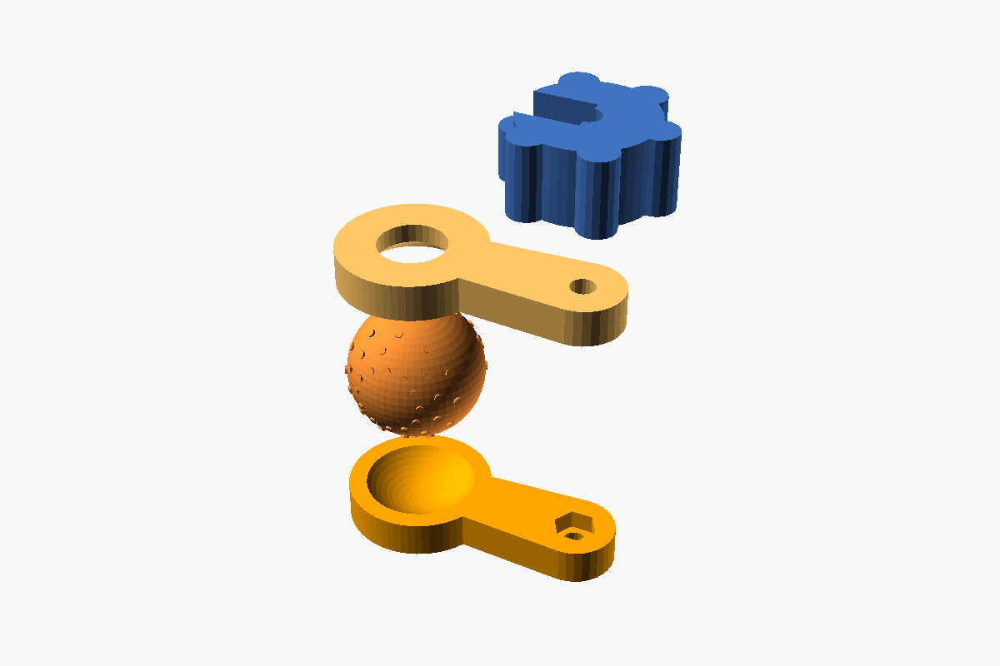 | 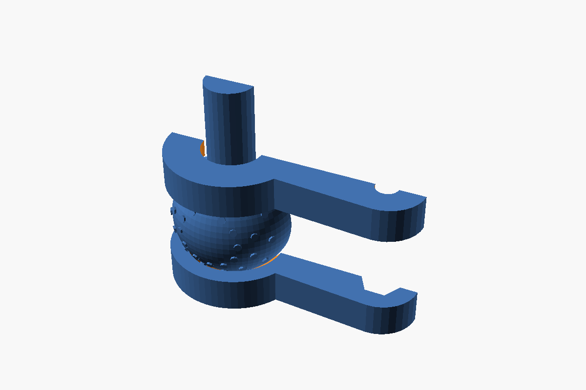 |

Source is `hot_spotter_2020.scad`. Export with `./build_2020.sh`. The EMT files further down are the previous arm.

## 2020 printed parts

| STL | Qty | What it is |
|---|---|---|
| `2020_foot` | 1 | Screw-down base. 140 mm flange, round sleeve for the post. Prints flange-down. |
| `2020_bench_clamp` | 1 | Bench-edge clamp, same job as the old C-clamp, sleeve for 2020. |
| `2020_clamp_knob` | 1 | Hand knob for the clamp's M8 screw. |
| `2020_clamp_pad` | 1 | Swivel pad on the clamp screw. |
| `2020_elbow_post` | 1 | Top of the post: sleeve plus the lower ball dish, captive M5 nut. |
| `2020_elbow_ball` | 1 | Textured ball. The pad on the neck bolts to the crossbar. |
| `2020_head_pad` | 1 | End of the crossbar: dish plus a pad that takes two T-nuts. |
| `2020_head_ball` | 1 | Camera ball and the clevis for the existing cradle tongue. |
| `2020_phone_carriage` | 1 | Slides on the post slot. One dish for the phone ball. |
| `2020_phone_ball` | 1 | Phone ball and clevis. |
| `2020_ball_cup` | 3 | Loose neck-side dish. One each for the elbow, the camera, and the phone. |
| `2020_ball_knob` | 4 | Three joint knobs, plus one to lock the phone height. |
| `2020_end_cap` | 4 | Caps. Ribs press into a pair of opposite slots. Two go on the crossbar; two are spare, since the post ends are hidden in the foot and the elbow sleeve. |
| `2020_cable_clip` | 6 | Snaps into the 6 mm slot and holds one cable. |

The cradle, phone grip, springs, and test-fit cradle are unchanged. Print those from the existing `stl/cradle.stl` and `stl/phone_*.stl` files.

### Print (PETG)

0.2 mm layers, 4 walls, 40% gyroid on the foot, clamp, sleeves, and balls. Cups, knobs, clips, and caps can be 3 walls. No supports. Cups and the carriage print dish-up. Balls print with the flat on the bed and the neck up (the flat is the 50° cap, so the wall stays under 40°). The foot prints flange-down. The clamp prints with the C flat on the bed; the post bore has a 45° roof so the horizontal tunnel needs no support. End caps print ribs-up. Cable clips print barb-up.

### Hardware

The foot and the bench clamp are two ways to hold the post. The counts below include both, so skipping one leaves you two T-nuts and two M5×12 bolts spare. Heat-set inserts: **none**. The three joint nuts are ordinary M5 hex nuts in a pocket. A brass insert in warm PETG can creep out of a clamp that stays tight.

| Qty | Item | Used for |
|---|---|---|
| 1 | 2020 extrusion, 1000 mm, 6 mm slot (V-slot or T-slot) | Cut 635 mm post and 350 mm crossbar. |
| 14 | M5 drop-in or hammer-head T-nuts | 12 in use, 2 spare. Foot 2, clamp 2, elbow sleeve 2, elbow ball 2, camera pad 2, phone carriage 2. |
| 11 | M5×12 button head | T-nut bolts, except the phone lock. |
| 1 | M5×25 button head | Phone height lock. Head sits in a `2020_ball_knob`, thread goes into a T-nut. |
| 3 | M5×45 socket head | Ball-joint clamp bolts. The head slides into the knob from the side. |
| 3 | M5 hex nut | Captive in `elbow_post`, `head_pad`, and `phone_carriage`. Not heat-set inserts. |
| 1 | M8×120 fully threaded bolt | Bench clamp screw. |
| 2 | M8 hex nut | One captive in the clamp, one locks the knob. |
| 1 | M8 acorn nut | Swivel tip of the clamp pad. |
| 4 | #10 × 1 in flat-head wood screws | Foot to a wooden top. #8 or M5 flat-head fits the same hole. |
| 2 | M6×40 bolt and nylock nut | Cradle tongue to `head_ball`, and phone tongue to `phone_ball`. Tighten once. |
| 2 | M3×12 pan head | Cradle keeper screws, same as before. |
| 1 | M3×16 pan head | Phone-grip spring follower, same as before. |
| 2 | Century Spring 3CS | Phone grip, same as before. |

Sleeve bolts go into **one** slot, through the plastic wall only. They do not pass through the aluminum. The phone carriage uses two T-nuts in the front slot. Leave the M5×12 snug so the plate cannot twist, and use the knob to lock the height. Loosen the knob to slide it.

### Holding torque

The elbow ball carries the crossbar. 350 mm of 2020 is about 0.16 kg, and the head plus the USB-C thermal camera is about 0.12 kg out at 300 mm. With the bar level, that is roughly **0.6 N·m** at the ball.

A firm one-hand twist on the 36 mm knob is about 0.4 N·m of bolt torque. For a dry M5 thread, preload is about T / (0.2 × 5 mm) ≈ **400 N**. The two dishes share it. The 0.40 mm bumps on the ball raise PETG-on-PETG from a slippery 0.2 to about 0.4. Contact radius is about 13 mm:

2 × 0.4 × 400 N × 0.013 m ≈ **4 N·m**.

That is several times the 0.6 N·m the boom needs. Half that twist is still above the load. The phone is about 0.2 kg at 70 mm, near 0.15 N·m, so its joint is easier. The seat is **0.35 mm** clear of the smooth sphere, and the bumps stand 0.40 mm proud, so a loose knob lets the ball move and a tight knob makes the dishes bite. The dishes are separate parts, so the bolt can actually close the gap. A captive nut is used instead of a heat-set insert: an insert in warm PETG can creep out of a clamp that stays tight. The nut cannot pull through the pocket.

If a joint sags, the knob was only pinched or the nut pocket has wallowed. Turn the knob until the dishes have closed. Do not use a wrench. The plastic around the M5 is the piece that should give first.

---

# Previous EMT arm

Clamp-on arm that holds a USB-C thermal camera **610 mm (2 ft) above the bench top, looking straight down**, for the Hot Spotter app.
At that height the 55° × 43° field of view covers about **635 × 480 mm** of bench, roughly 4 mm per thermal pixel.

The upright can sit in the bench clamp, or in an optional screw-down base pad when the top is wood you can screw into. Both grips are the same socket and the same two pinch bolts, so the post, the phone holder, and the camera move from one to the other without a new tube.

**License:** Copyright (c) 2026 goeielewe. Licensed under the Apache License, Version 2.0. See the repo [LICENSE](../../LICENSE).

| Assembly on the bench edge | Side view | Cradle | Phone holder |
|---|---|---|---|
| 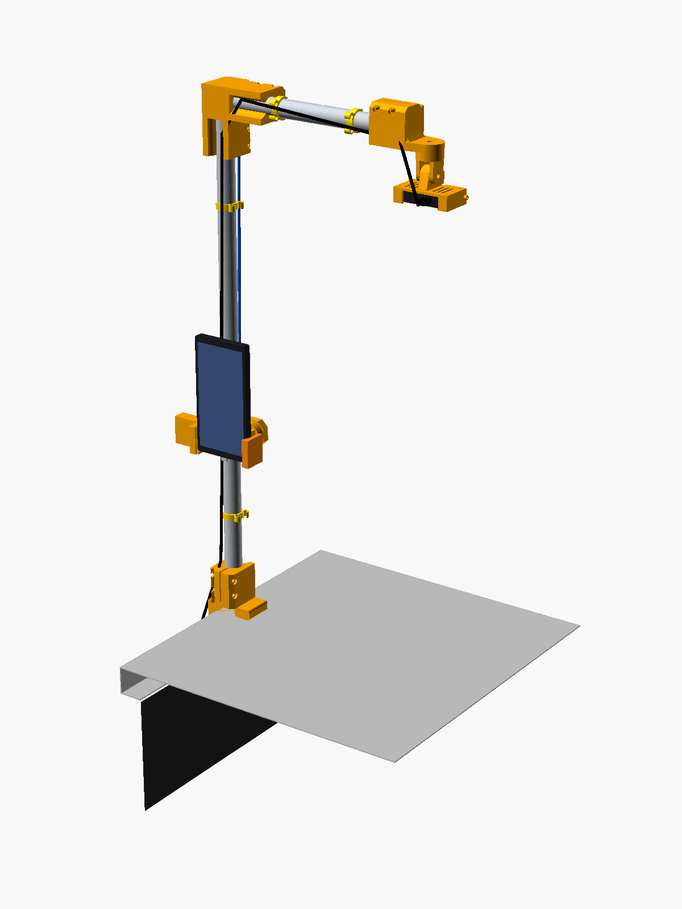 | 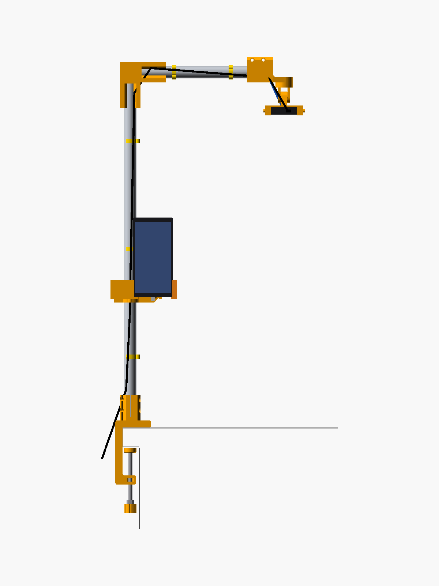 | 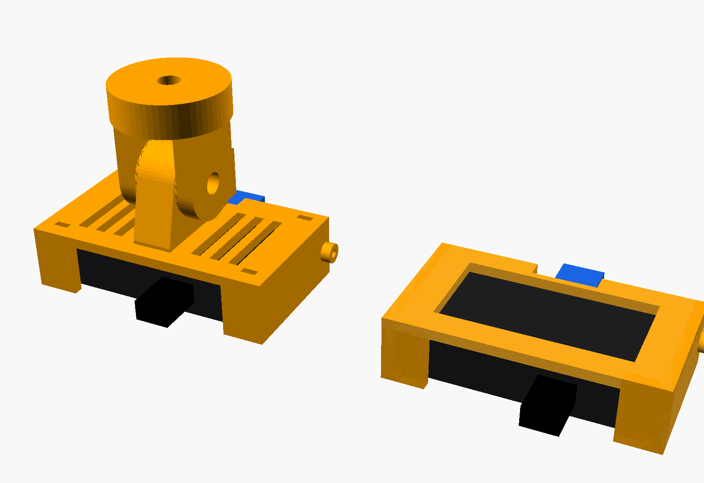 | 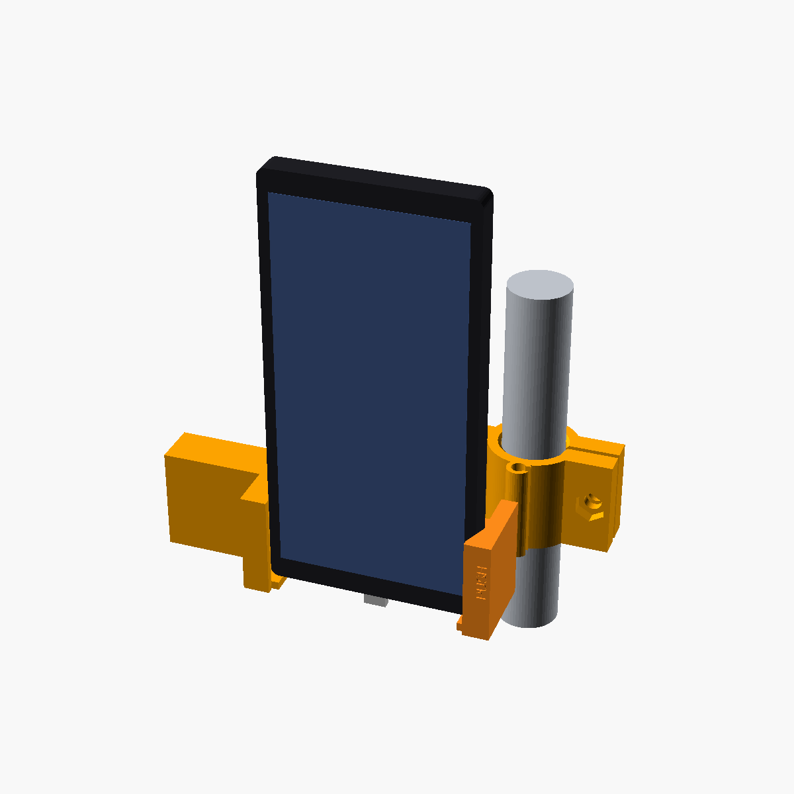 |

> ## ⚠️ Print `cradle_testfit.stl` FIRST
> The camera dimensions come from the datasheet (68 × 34 × 14 mm). Lens position, corner radii and port positions are estimated.
> The test-fit cradle is a 25-minute print with no tongue. Use it to check that:
> * the camera slides in snugly and the crush ribs grip it;
> * the lens and thermal window are not covered by the 2 mm end lips;
> * the power button, LED and charge port line up with the 50 mm opening in the bottom edge;
> * your USB-C extension's socket fits the notch in the back plate.
>
> If anything is off, change `cam_L / cam_W / cam_T`, `fit`, `rib_h`, `lip_w` or `bottom_open` at the top of the `.scad`, re-export, and test again. Only then print the real `cradle.stl`.

## Files

| File | What it is |
|---|---|
| `hot_spotter_bench_arm.scad` | Parametric OpenSCAD source. Every part is selected with `part=`, and all key dimensions are named at the top. |
| `stl/*.stl` | Ready-to-print parts, already in print orientation |
| `images/*.png` | Renders: the assembly on a bench edge (`assembly.png`, `assembly_side.png`), the clamp (`clamp_closeup.png`, `clamp_section_side.png`), the screw-down pad (`base_pad.png`, `base_pad_on_bench.png`, `base_pad_section.png`), the cradle (`cradle.png`, `cradle_from_below.png`) the printed-arm variant (`assembly_printed_variant.png`) and the phone holder (`phone_holder.png`, `phone_holder_back.png`, `phone_grip_section.png`) |
| `build.sh` | Re-exports every STL (`openscad` must be on your PATH) |
| `check_stl.py` | Checks each STL for manifold/watertight geometry and confirms it fits a 220×220×250 bed |

## Printed parts (main design: EMT tube arm)

| STL | Qty | Bounding box X×Y×Z (mm) | Notes |
|---|---|---|---|
| `clamp_body` | 1 | 69.0 × 175.0 × 50.0 | Prints on its side, with the C-shape flat on the bed. Layers run along the C, so they carry the bending load. |
| `clamp_knob` | 1 | 23.5 × 23.5 × 18.0 | Prints with the hex pocket up. |
| `clamp_pad` | 1 | 24.0 × 24.0 × 10.0 | Swivel pad. Prints with the flat (rubber) face down. |
| `elbow` | 1 | 90.0 × 90.0 × 50.0 | Prints flat. Both bores are horizontal, with teardrop roofs. |
| `boom_head` | 1 | 40.0 × 89.0 × 50.0 | Boom socket plus the pan plate. Prints with the plate on the bed. |
| `yoke` | **2** | 34.0 × 34.0 × 40.0 | Pan disk plus tilt ears. Prints disk-down. One for the camera, one for the phone holder. |
| `cradle` | 1 | 80.4 × 46.0 × 42.4 | Prints standing on the plug-side edge. Use a brim. |
| `cradle_testfit` | 1 | 80.4 × 19.0 × 42.4 | **Print first.** Same pocket as the cradle, without the tongue. Use a brim. |
| `cable_clip` | 6 | 27.6 × 28.8 × 8.0 | Snaps onto the tube and holds two USB-C cables. |
| `phone_collar` | 1 | 87.9 × 47.3 × 36.0 | Phone holder: split collar for the post, with the swivel plate and two cable hooks. Prints standing up (bore vertical). Use a brim. |
| `phone_body` | 1 | 99.7 × 60.6 × 37.0 | Phone holder: grip body with the fixed jaw, spring channel and tilt tongue. Prints on its bottom edge. Use a brim. |
| `phone_slider` | 1 | 101.2 × 37.0 × 30.4 | Phone holder: sliding jaw with the spring window. Prints flat. Use a brim. |
| `phone_follower` | 1 | 8.0 × 8.5 × 8.8 | Phone holder: fixed spring seat, held by one M3 screw. |
| `phone_spacer` | 1 | 20.0 × 8.5 × 8.8 | Phone holder: range spacer, engraved "58-80". In for 58–80 mm phones, out for 78–100 mm. |
| `base_pad` | 1 | 140.0 × 140.0 × 82.0 | Optional, instead of the clamp. Prints flange-down, socket up. Four countersunk holes for flat-head wood screws. |

That makes 15 STL files. The base pad is optional. Without it, the build is 20 printed pieces including the test-fit cradle (15 pieces without the phone holder). Every part checked as a manifold, watertight single body, and the largest (175 mm) leaves at least 45 mm of margin on the 220 × 220 bed. Expect roughly 300–400 g of filament for the clamp build. The pad's solid volume is about 390 cm³, so even with infill it is a few hundred grams on its own.

### Printed-arm variant (no tube)

| STL | Qty | Bounding box X×Y×Z (mm) |
|---|---|---|
| `arm_post_end` | 2 | 201.6 × 21.6 × 21.6 |
| `arm_post_mid` | 2 | 201.6 × 21.6 × 21.6 |
| `arm_boom_end` | 2 | 151.5 × 21.6 × 21.6 |

These are solid octagonal bars, 21.6 mm across flats and 23.42 mm across corners, so they fit the same sockets as EMT. They join with 50 mm half-lap joints that have a V key and 2 × M5 bolts, with nut traps printed in.
* **Post:** end + mid + mid + end.
* **Boom:** end + end.

Every other piece is turned over so the laps mate. See `images/assembly_printed_variant.png`. All pieces print lap-face up, with no supports. Use 100% infill or 6+ walls.

## Print settings (Ender 3 Pro)

* **Material:** **PETG recommended.** PLA works, but it creeps under constant bolt and clamp load and softens around 55 °C. That matters next to a soldering iron or hot cells.
* **Layers:** 0.2 mm. 0.16 mm is optional for the cradle.
* **Clamp, elbow, boom head, yoke, base pad:** 4 walls (1.6 mm), 5 top/bottom layers, 40–50% gyroid. The pad's ribs carry the arm's moment into the screws, so don't print it sparse.
* **Base pad:** flange on the bed, socket pointing up. No supports. The bore is vertical. The four screw holes are countersunk on the top face. A 5 mm brim is unnecessary; the flange is the bed contact.
* **Cradle, knob, pad, clips:** 3 walls, 25% infill.
* **Supports:** none. Every horizontal hole is a teardrop or small enough to bridge.
* **Brim:** 5 mm on the cradle and test-fit cradle, which stand on a narrow edge.
* **Elephant's foot:** check the nut traps. A 0.2 mm horizontal expansion compensation (or a quick deburr) helps the M8 nut slide into the clamp.

## Hardware (all metric, plus one piece of tube)

| Qty | Item | Used for |
|---|---|---|
| 1 | 3/4" EMT conduit (OD 23.4 mm). One 10 ft (3 m) stick, or any offcut over 0.91 m. Cut **656 mm** (post) and **253 mm** (boom), then deburr. | The arm. |
| 1 | M8 × 120 hex bolt, **fully threaded** (DIN 933 / ISO 4017), or a 120 mm length of M8 threaded rod | Clamp screw. M8 × 110 also works. |
| 2 | M8 hex nut (DIN 934) | One is captive in the lower jaw. The other locks the knob onto the bolt. |
| 1 | M8 acorn / cap nut (DIN 1587) | Swivel tip. It snaps into the pad. |
| 8 | M5 × 40 socket head cap screw (ISO 4762) | Pinch bolts: 2 per socket × 4 sockets. |
| 8 | M5 hex nut | In the nut traps. |
| 1 | M6 × 30 hex bolt (DIN 933) | Pan axis. The head is captive in the yoke. |
| 1 | M6 × 40 hex bolt | Tilt axis. |
| 2 | M6 wing nut (DIN 315) | Lock pan and tilt by hand. |
| 4 | M6 flat washer | Pan wing nut, both sides of the tilt joint, and 1 spare. |
| 2 | M3 × 12 pan-head screw (or self-tapping plastic screw) | Camera keeper screws. |
| — | 1.5 mm self-adhesive rubber sheet or pads | Top jaw underside and pad face (optionally the cradle lips). |
| ~4 | Zip ties, 2.5–3.6 mm wide | Strain relief at the cradle. |
| 1 | USB-C male-to-female extension, **data-capable** (USB 3.x / "full-featured") | Camera to phone. |
| 1 | USB-C cable plus a 5 V / 1 A or higher charger | Camera charge port. |
| *Phone holder* | see [Phone holder hardware](#hardware-phone-holder) | 2 springs, M3 × 16, 2 × M6 × 30, 1 × M6 × 40, 3 wing nuts, 4 washers. |
| *Base pad, instead of the clamp* | 4 × #10 × 1 in (25 mm) flat-head wood screws, 90°. A #8 or an M5 flat-head wood screw fits the same hole. | Screw the pad to a wooden top. See [Screw-down base pad](#screw-down-base-pad). |
| *Both mounts kept ready* | 2 extra M5 × 40 socket cap screws and 2 extra M5 nuts | So the clamp socket and the pad socket can each keep their pinch bolts. |
| *Printed variant only* | 8 × M5 × 25 socket cap screws and 8 × M5 nuts, **instead of the EMT** | Lap joints. |

## Assembly

1. **Clamp:**
   * Push an M8 nut into the slot in the lower jaw until it drops into the hex pocket.
   * Put the M8 bolt head into the knob's hex pocket, so the shaft comes out of the fluted side.
   * Run the second M8 nut down tight against the knob face. This locks the knob to the bolt.
   * Thread the bolt up through the captive nut from below.
   * Spin the acorn nut onto the tip and snap the pad over it. It should swivel freely.
   * Stick rubber on the pad face and on the underside of the top jaw.
2. **Mount** (see `images/clamp_section_side.png`):
   * Hook the top jaw over the bench edge, with the post socket pointing up.
   * The lower jaw sits 26 mm in from the front face. Your 32 mm lip leaves about 6 mm before the perforated panel.
   * Wind the knob up until the pad bites the underside lip, then give it a firm hand-tight twist. **Don't use a wrench:** hand torque on the knob already gives around 900 N of clamping force.
3. **Post:**
   * Push the 656 mm tube fully into the clamp socket, so it bottoms on the jaw.
   * Snug both M5 pinch bolts evenly until the slit has just closed up on the tube.
4. **Elbow and boom:**
   * Fit the elbow on top of the post, with its other socket aimed over the bench.
   * Push the 253 mm boom into the elbow, then fit the boom head on its end with the pan plate underneath.
   * Square everything up and tighten the pinch bolts.
5. **Pan:**
   * Drop the M6 × 30 bolt head into the hex pocket between the yoke ears.
   * Pass the bolt up through the pan plate, then add a washer and a wing nut.
6. **Cradle and camera:**
   * Slide the camera into the cradle from the plug side. Put the lens face against the end lips, with the charge port toward the bottom-edge opening.
   * Drive the two M3 keeper screws in until their tips sit over the camera's top corners.
   * Plug the USB-C extension into the camera plug, then zip-tie it through the back-plate slots.
7. **Tilt:**
   * Put the cradle tongue between the yoke ears.
   * Pass the M6 × 40 bolt through with a washer on each side, and lock it with a wing nut. The 24-tooth rings lock tilt in 15° steps.
   * Aim the camera straight down. Pan and tilt both lock by hand.
8. **Cables:**
   * Snap 3 clips on the post and 2 on the boom (one spare).
   * Lay the extension cable and the charge cable in the two hooks of each clip.
   * Leave a slack loop at the yoke so pan and tilt don't pull on the plugs.
   * If you fit the phone holder, run both cables through the two hooks on its collar as well (one cable per hook).

To fine-tune the height, slide the post in its sockets before tightening, or change `cam_height` and re-cut the tube. The `.scad` echoes the cut lengths when it renders.

### Screw-down base pad

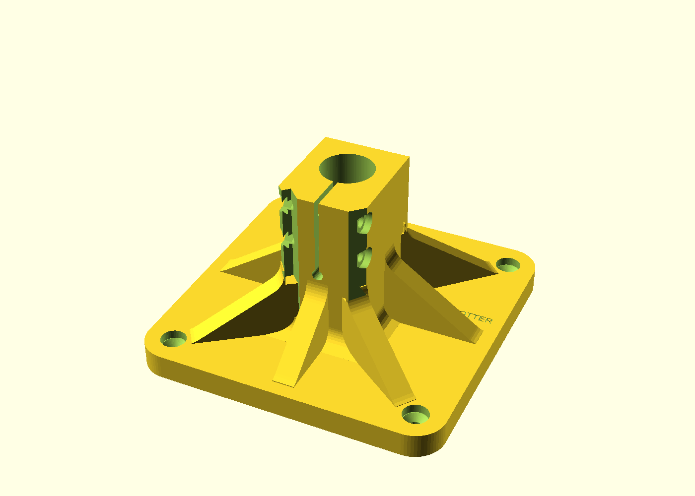
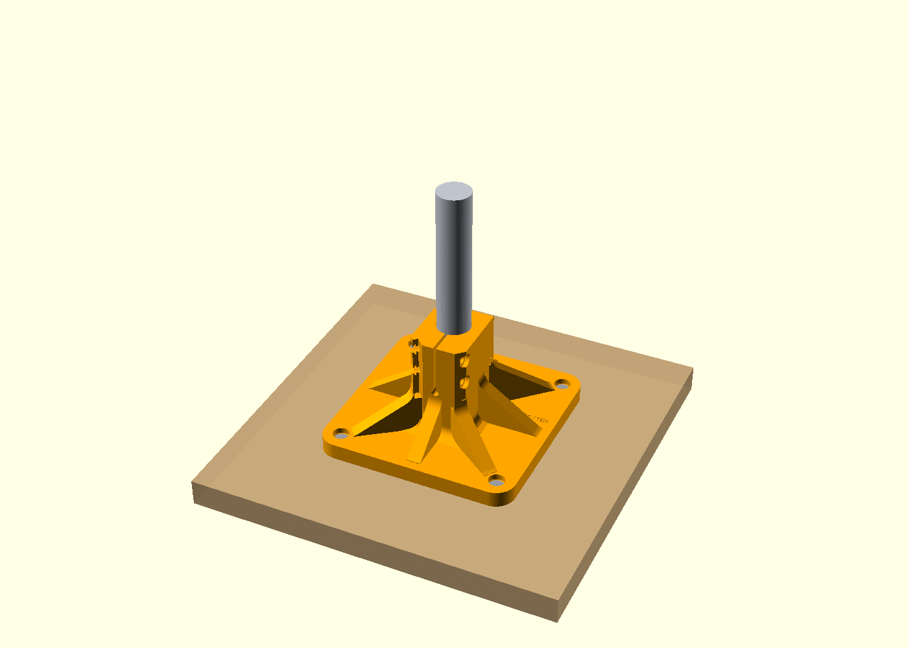
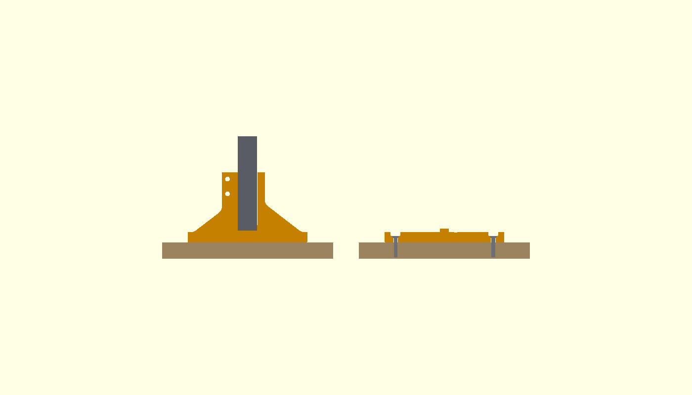

Use this instead of the clamp when the bench has no edge to grip, or when you want the arm planted in the middle of a wooden top. The phone stays in its spring holder on the post, and the USB-C thermal camera stays on the boom. The clamp is unchanged. You can move the arm back to the clamp later.

**How the upright is held today.** On the clamp, the 3/4" EMT drops into the socket on the top jaw and bottoms on that jaw, 14 mm above the bench. A slit runs along the socket. Two M5 × 40 screws and nuts pinch the slit shut, so the tube cannot slide or spin. Loosen those two screws and the post pulls straight out.

**How the pad holds the same upright.** The pad is that same socket, standing on a 140 mm square flange with 14 mm corner radii. The bore floor is also 14 mm above the wood, so the 656 mm post and the camera height do not change. The socket is 70 mm tall, taller than the clamp's 50 mm. The bottom 34 mm is a solid ring. The slit, the two pinch bolts, and a 5 mm round relief at the bottom of the slit are only above that ring, so the tube cannot cock in the hole. Eight ribs run from the socket out toward the screws.

**Screws.** Four holes sit on a 114 mm square, 57 mm each side of the post. Each hole is a 5.5 mm clearance, a 90° countersink 11 mm across, and a 4 mm counterbore so the head sits below the flange top. A #10 × 1 in flat-head wood screw then puts about 17 mm of thread into the wood. A #8 or an M5 flat-head wood screw uses the same hole.

* The top should be at least 18 mm thick (3/4 in plywood or solid wood) so a 1 in screw does not break out underneath.
* On a thicker top, use #10 × 1-1/4 in or 1-1/2 in so more thread is in the wood.
* Do not use a screw long enough to come out the bottom.
* Drill a small pilot (about 2.5 mm in softwood, 3 mm in hardwood), then drive the four screws until the flange is tight and flat. The heads should sit in the countersinks and not rock.

**Swap.** Loosen the two M5 pinch bolts, pull the post straight out, push it into the other socket until it bottoms, and tighten those two bolts. Elbow, boom, cradle, and phone holder stay on the tubes. To leave both mounts ready, fit the extra pair of M5 screws and nuts listed above instead of moving the bolts each time.

## Phone holder (on the post)

A spring-loaded phone grip clamps onto the vertical post, so the phone running Hot Spotter sits next to the arm instead of on the bench. It uses the same pan/tilt idea as the camera head: an M6 swivel on the collar plus a toothed M6 tilt joint (a second printed `yoke`).

| Back (collar, swivel, tilt) | Section: grip at 75 mm (spacer in) and 92 mm (spacer out) |
|---|---|
| 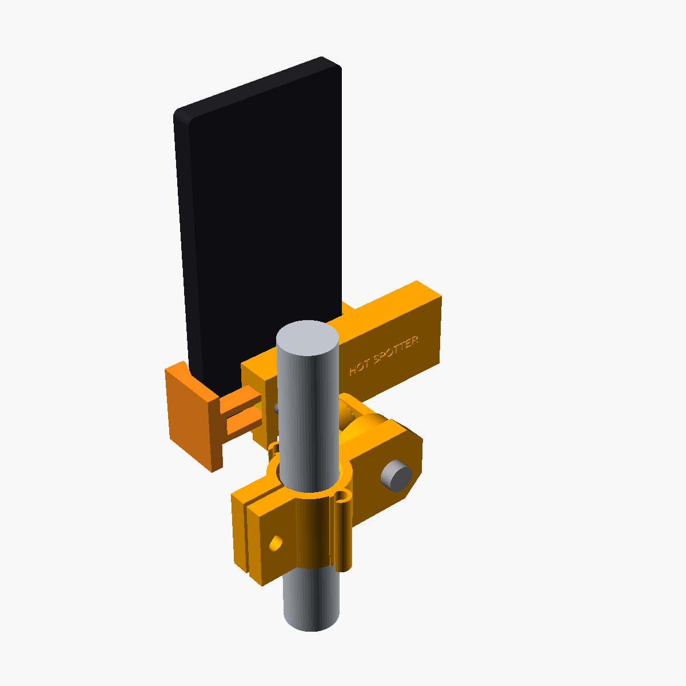 | 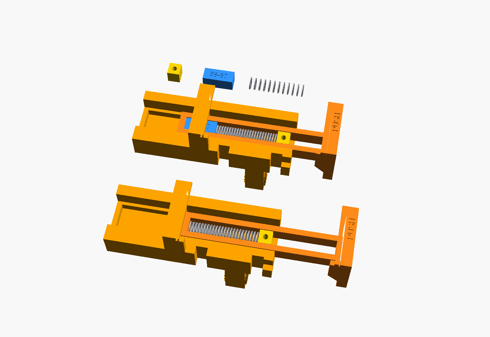 |

### What it holds

* **Phone width (in its case): 58–100 mm**, in two ranges set by the printed spacer:
  * **Range A, spacer IN:** 58–80 mm (most phones in a slim case).
  * **Range B, spacer OUT:** 78–100 mm (large phones in thick or rugged cases).
* **Grip force:** about 3.2 N at the narrow end of each range rising to about 6.6 N at the wide end (about 7.5 N with the jaw pulled fully open). That is enough to hold a phone against bumps and cable tug, while still opening with one thumb.
* **Thickness:** the jaws stand 17 mm above the rest face and have a 3.5 mm inward lip, so phones about 8–14 mm thick (with case) are held front and back.
* **Ports and buttons:** each jaw covers only the lowest 37 mm of the phone's long side, so side buttons above that stay clear. The bottom ledges reach only 6 mm in, so the bottom USB-C port, speaker and mic stay open. Two 7 mm cable notches in the body's bottom edge let a cable leave straight down.

### How it works

* The **body** carries the fixed jaw and a closed channel. The **slider** (moving jaw) runs in the channel, and a 8.9 mm window in the slider holds the springs.
* Two compression springs, end to end, sit in the window between the slider's window end and the **follower**, a small block screwed to the body with one M3 screw from the back. Pulling the jaw open compresses the springs, so the jaw always pulls closed.
* The **spacer** sits in the window in series with the springs. With it in, the springs are pre-loaded so narrow phones are gripped. Pull it out for wide phones. With the spacer out and no phone, the springs are about 4 mm loose and the jaw can rattle; that's normal.
* Fully open (100 mm phone plus 6 mm to get it in), each spring is deflected 24 mm out of its 30.5 mm rated maximum, so they never go solid or take a set.

### Why steel springs, not a printed flexure

* **PETG creeps** under constant strain. A printed flexure held open by a phone all day loses grip within weeks, and faster when warm, which matters next to a soldering iron.
* The grip needs **about 42 mm of jaw travel** (58→100 mm). A PETG flexure that bends that far without yielding would be long and bulky; a steel spring does it in 76 mm with a constant, predictable rate.
* Steel springs are cheap, standard and replaceable. If the grip is too weak or too strong, swap the spring instead of reprinting.

### Hardware: phone holder

| Qty | Item | Used for |
|---|---|---|
| 2 | **Compression spring, Century Spring No. 3CS** (music wire, zinc plated): **OD 0.312" (7.92 mm), free length 1.5" (38.1 mm), wire 0.023" (0.58 mm), rate 1.8 lb/in (0.315 N/mm), solid 7.11 mm, max deflection 1.2" (30.5 mm), closed ends.** | Jaw springs, used end to end in series. Any equivalent works: **5/16" (7.5–8.0 mm) OD × 1-1/2" (38 mm) long, 1.5–2.2 lb/in (0.26–0.39 N/mm)**, at least 28 mm of rated travel. Do not use an OD above 8.0 mm; the window is 8.9 mm wide. |
| 1 | M3 × 16 pan-head screw (or self-tapping plastic screw) | Holds the follower. It goes in from the back, through the follower, into the 2.6 mm pilot in the front wall. |
| 2 | M6 × 30 hex bolt | Collar pinch bolt (head in the hex pocket), and the swivel (head captive in the yoke). |
| 1 | M6 × 40 hex bolt | Tilt axis. |
| 3 | M6 wing nut (DIN 315) | Collar, swivel and tilt, all by hand. |
| 4 | M6 flat washer | Swivel wing nut, both sides of the tilt joint, and one under the collar wing nut. |
| — | 1.5 mm self-adhesive rubber | Inside faces of both jaws and the bottom ledges. |

The grip, collar and swivel use no tools beyond a screwdriver for the M3.

### Print settings: phone holder

* **Material:** PETG, as for the rest. 0.2 mm layers.
* **`phone_body`, `phone_slider`, `phone_collar`:** 4 walls, 5 top/bottom layers, 30–40% gyroid. **5 mm brim** on all three (they stand on narrow faces or have long thin edges).
* **`phone_follower`, `phone_spacer`:** 3 walls, 100% infill (they're tiny).
* **Second `yoke`:** same settings as the first.
* **Supports:** none. Every horizontal hole is a teardrop. The body prints on its bottom edge so the spring channel runs along the bed with a bridged roof, and the tilt hole is a teardrop pointing up.
* **Cleanup:** scrape any elephant's foot off the slider edges and the inside of the channel. The slider must slide freely before the springs go in.

### Assembly: phone holder

1. **Grip:**
   * Stick 1.5 mm rubber on the inside face of each jaw and on the top of each bottom ledge.
   * Slide the slider into the channel from the open end, with the "PUSH" tab on the outside. It should move freely end to end with no springs fitted.
   * Pull the jaw fully open. Drop the two springs end to end into the slider window, then the follower, so the follower lines up with the M3 hole. For phones 58–80 mm also drop in the spacer (between the springs and the window end, see `images/phone_grip_section.png`).
   * Drive the M3 × 16 from the back of the body through the follower into the front-wall pilot. Snug, don't strip.
   * Let the jaw close. It should snap shut against the body end.
2. **Collar:**
   * Open the slit with a screwdriver if needed and slide the collar onto the post. Put the M6 × 30 head in the hex pocket, add a washer and a wing nut, and tighten by hand.
   * On the printed arm, put the collar on a plain part of a segment, not on a lap joint.
   * Set the height before mounting the cable clips; the default is about 230 mm above the clamp, between the lower two post clips.
3. **Swivel:** put a second yoke on the swivel plate (either face, to put the phone on either side), M6 × 30 head captive in the yoke, through the plate, washer and wing nut.
4. **Tilt:** put the body's tongue between the yoke ears, M6 × 40 with a washer each side, wing nut. The 24-tooth rings lock tilt in 15° steps.
5. **Phone:** pull the jaw open by the "PUSH" tab, set the phone on the ledges, and let go.
6. **Cables:** run both arm cables through the collar's hooks. If you need to charge the phone, run its cable out through a notch in the body's bottom edge.

> **Charging:** the phone's USB-C port is used by the camera's extension cable. To charge while running, use wireless charging or a USB-C PD splitter/hub that passes data and power.

### Test-fit first

1. **Print `phone_collar` and `phone_slider` first** (small, quick prints).
2. **Collar on the post:** it should slide on with light force and lock solid with the wing nut hand-tight. If the slit is fully closed before it grips, the post is undersize; if it won't go on, increase `tube_clear` slightly.
3. **Springs in the slider window:** both springs must drop in and move freely in the 8.9 mm window. If you can't find 3CS, measure your spring's OD before buying a pair.
4. **Then print `phone_body`** and check the slider runs freely in the channel before fitting springs.
5. **Phone fit:** check that the jaws sit below the side buttons, the bottom port and speaker are clear of the ledges, and that the lip holds your phone's case front edge. Change `jaw_h` / `lip_in` / `ledge` in the `.scad` if needed.
6. **Follower screw:** check the M3 lines up with the follower hole and bites the pilot. If the pilot is loose, use a slightly longer self-tapping screw.
7. Grip strength is set by the spring. For a firmer grip use a stiffer spring of the same size (around 2.5 lb/in), not a shorter one, so the springs don't go solid at full open.

## Design choices

**Main design: 3/4" EMT tube with printed fittings.**
* A 3/4" EMT stick is cheap at any hardware store, comes pre-straightened, and is about **40× stiffer** than a printed bar of the same size (steel vs PETG).
* It needs no long prints. A printed 0.66 m post would take 4 segments and 3 bolted joints.
* The fittings are clamp sockets with a slit and 2 × M5 pinch bolts, so the tube can't rotate or slide, and the height is adjustable before tightening.
* A 1" (25.4 mm) wooden dowel also works: set `tube_d = 25.4` and re-export the sockets and clips. Use a straight hardwood dowel, since pine sags.

**Alternative: fully printed segmented arm.**
* It uses the same sockets and fittings. The octagon's across-corners size equals the EMT OD.
* It works, but expect a few mm of sag and visible wobble at the camera. That comes from PETG's flex, slop in the lap joints, and long-term creep.
* Use it if you can't get tube.

**Screw-down base pad.** It is the alternative to the clamp, not a replacement for the tube or the head. The post length and the camera height stay the same because the tube bottoms 14 mm up in either socket. Print it in PETG. A sparse pad will creep where the ribs meet the flange.

**Bench clamp.**
* It's a C-clamp sized for edges from 10 to 70 mm, so a single bolt length covers the whole range. At a 10 mm edge there is still 5.5 mm of spare thread.
* The low-profile lower jaw reaches only 26 mm under the edge. Your bench has a 32 mm lip before the perforated panel.
* The knob, at Ø24 on the screw axis 15 mm in from the front face, stays inside 27 mm.
* The swivel pad lets the screw seat flat on a slightly angled or uneven lip.

**Cradle.** It has a friction fit plus a positive keeper:
* The pocket is 0.2 mm oversize per side, with 0.35 mm crush ribs on the end walls.
* 2 mm lips at each end hold the lens face.
* Corner stops on the bottom edge leave a 50 mm opening for the button, LED and charge port.
* Two M3 keeper screws close the open plug side.
* The plug side is open, with a notch in the back plate, so the extension cable's socket body clears. Vents and zip-tie slots are in the back plate.

**Pan and tilt.**
* Pan: an M6 bolt and wing nut through a 34 mm disk.
* Tilt: a horizontal M6 bolt and wing nut through the yoke ears. 24-tooth radial locking rings on the ears and tongue stop the camera from drooping.

## Leverage and stability check

* **Static load:**
  * About 0.15 kg of boom at around 0.15 m, plus about 0.16 kg of head, yoke, cradle, camera and hardware at 0.3 m, plus cables.
  * That gives about **0.8 N·m** of overturning moment at the clamp.
  * The top jaw reaches 55 mm, the pad is 15 mm in, and the lever between them is about 40 mm. Holding 0.8 N·m takes about **20 N**, against roughly 900 N of hand-tight clamping force (more than 40× margin).
  * A 10 N knock at the elbow (about 7 N·m) needs only about 175 N.
* **Deflection, EMT (E = 200 GPa, I ≈ 4,700 mm⁴):**
  * The boom tip sags about 0.01 mm.
  * The post tilt under the static moment drops the camera about 0.2 mm.
  * In practice, wobble is set by how tight the pinch bolts are, not by the tube.
* **Deflection, printed variant (PETG E ≈ 2 GPa, I ≈ 12,000 mm⁴):**
  * The post tilts about 1.2°, so the camera drops around 6 mm.
  * Add joint slop and slow creep on top of that. This is why tube is the main design.
* **Clamp spine stress:**
  * About 900 N acting about 22 mm from the spine gives roughly 15 MPa in the 14 × 40 mm PETG spine. PETG yields at about 45 MPa, so the margin is about 3×.
  * Don't extend the knob with pliers.
* **Phone holder:** a phone of about 0.2–0.25 kg plus about 0.13 kg of holder sits about 0.07 m out from the post, roughly 0.35 m above the clamp. That adds only about **0.25 N·m**, so the total stays near 1 N·m, still more than 40× under the clamp's grip. Put it on the front or side of the post, and keep it low (around 200–300 mm up) so knocks to the phone don't lever the post.
* **Recommended:** run the cables down the post, not dangling off the boom. Their weight then adds almost no moment.
* **Base pad:** the same static moment, about 1 N·m with the phone holder, lands on four screws 114 mm apart along the boom. Holding it takes about 9 N on the far pair, about 5 N each. A 10 N knock at the elbow is about 7 N·m, about 30 N on each of those two screws. A #10 × 1 in screw with about 17 mm of thread in pine withdraws at roughly 250 N, and hardwood is higher, so the knock is still about 8× under the screws and the static load is about 50× under them. The flange is flat on the table once the heads are seated, so the pad does not rock. What is left of the wobble is the pinch bolts, the same as on the clamp. The taller solid ring at the bottom of the socket is there so the tube itself cannot tilt inside the plastic.

## Uncertainties: camera geometry

The model uses the USB-C thermal camera datasheet size, **68 × 34 × 14 mm** (36.5 g), and the layout drawing in the user guide. Not verified on a real unit:
* **Lens/thermal window position:** estimated at 10–22 mm from one short end. The lips only cover 2 mm at each end, so there's plenty of margin, but check it on the test-fit print.
* **Power button, LED and charge port** on the bottom edge: exact positions unknown, so the whole middle 50 mm of that edge is left open. If something sits under a corner stop, increase `bottom_open`.
* **Corner radii, taper or step on the front face, and actual tolerances** versus the datasheet: tune `fit` and `rib_h` if the fit is loose or tight.
* **Extension-cable socket body:** its size depends on the brand. The back plate is notched 18 mm wide. Slim, straight extensions fit best, and a right-angle one may not.
* **Charging while running:** whether the camera charges through its own port while streaming over its plug depends on the firmware. Check it, or run on battery and charge between sessions.
* **Bench edge:** modelled as a 38 mm vertical apron with a 32 mm return lip. The real apron looks slightly angled in the photo, and the swivel pad absorbs that.

Edit the named parameters at the top of the `.scad` to change any of this (bench range, `cam_height`, `boom_reach`, tube size, camera size, fit).
